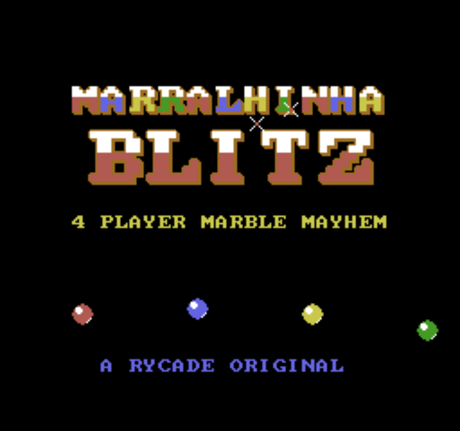
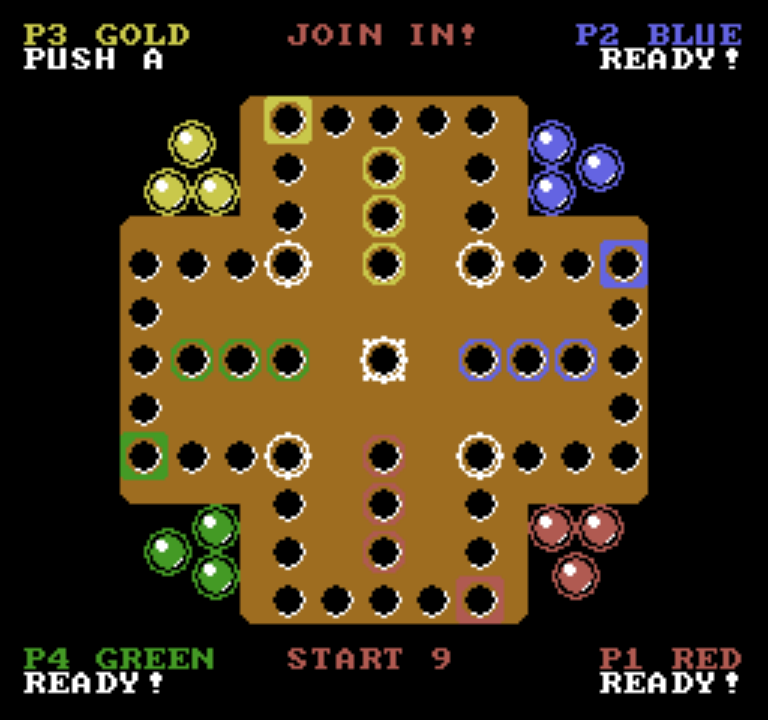
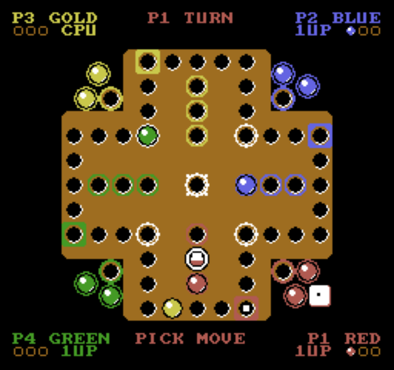
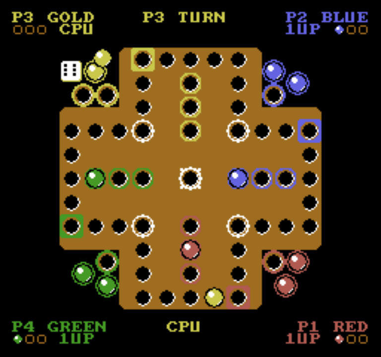
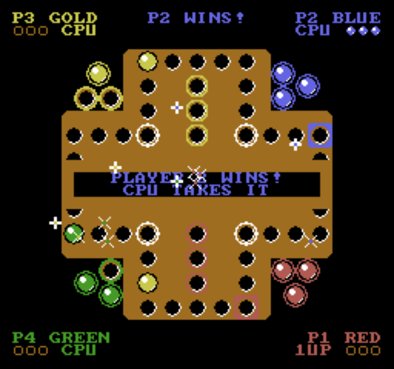

<p align="center">
  
</p>

<p align="center">
  <b>Marralhinha Blitz, demade into a real four player Famicom / NES cartridge.</b><br />
  Built for a 4 seat arcade cabinet · runs in MAME or any NES emulator · 40 KB ROM
</p>

<p align="center">
  <a href="https://marralhinha.app"></a>
  <a href="https://github.com/ryanpolasky/Marralhinha"></a>
</p>

This is the Blitz mode of [Marralhinha](https://github.com/ryanpolasky/Marralhinha), the marble game from Terceira, Açores (play it online at [marralhinha.app](https://marralhinha.app)), rebuilt from scratch for 1983 hardware. Three marbles each, a 40 hole cross, the center shortcut, and captures that send your friends back to their dish. Four people on four controllers, CPUs fill whatever seats are empty.

It's a genuine iNES ROM (mapper 0, 32 KB PRG + 8 KB CHR, no extra cartridge RAM), written in C with cc65 and a hand rolled 6502 runtime. The rules are a line for line port of the web game's `rules.js`, and a test diffs the two engines move by move.

## Screens

<table>
  <tr>
    <td></td>
    <td></td>
  </tr>
  <tr>
    <td align="center">Everyone hits A to grab a seat</td>
    <td align="center">Cycle your legal moves and pick one</td>
  </tr>
  <tr>
    <td></td>
    <td></td>
  </tr>
  <tr>
    <td align="center">Marbles hop cell by cell</td>
    <td align="center">Confetti, flashing colors, a fanfare</td>
  </tr>
</table>

## What's in the cart

- **Four players, real hardware protocols.** Reads Famicom expansion pads, the NES Four Score and the Hori 4 Players adaptor every frame, so it works however your controllers are wired.
- **Arcade flow.** Title screen with music, an attract demo where four CPUs play each other, a join screen with a countdown, and idle players get auto played so the cabinet never stalls.
- **The real rules.** Enter on a 1 or 6, roll again on a 6, exact rolls into home, captures, and the corner shortcut through the center. Same engine as [marralhinha.app](https://marralhinha.app).
- **CPU opponents** using the web game's bot scoring (progress, captures, threat avoidance).
- **Juice.** A tumbling die thrown from each player's corner, hop animations with rising blips, capture knockbacks with screen shake, sparkles, a win banner with confetti, and a start jingle and win fanfare on the NES APU.
- **A real soundtrack.** Chiptune arrangements of the Marralhinha theme. The **Hybrid mix** plays by default, and the moment anyone gets down to their last marble the music cuts to the faster **Arcade mix** ("LAST ONE!"). A more literal **Original mix** is in the ROM too.

## Play it

Grab [`blitz.nes`](blitz.nes) and load it in any NES emulator. For four players in MAME:

```
mame famicom -exp hori_twin -cart blitz.nes
```

or, as an NES with a Four Score:

```
mame nes -ctrl1 4score_p1p3 -ctrl2 4score_p2p4 -cart blitz.nes
```

### Controls

| | Move | A | B | Start |
| --- | --- | --- | --- | --- |
| P1 | Arrows | Alt | Ctrl | 1 |
| P2 | R D F G | S | A | 2 |
| P3 | I J K L | Right Shift | Right Ctrl | 3 |
| P4 | Numpad 8 4 2 6 | Numpad Del | Numpad 0 | 4 |

Those are MAME's default keys. On your turn, A rolls, the d-pad cycles through legal moves, and A confirms.

### In the browser

The [`web/`](web) folder is a static site (jsnes plus a 1 player build of the ROM) meant for Cloudflare Pages: 1 player against 3 CPUs, keyboard, gamepad and touch controls, volume, CRT filter and fullscreen. Serve it locally with `python -m http.server -d web 8787`.

### MAME tip

Tired of Esc closing MAME mid game? Copy [`mame/default.cfg`](mame/default.cfg) into your MAME `cfg` folder: Esc (or F5) pauses, and Shift+Esc quits.

## Build it

You'll need [Node](https://nodejs.org) and [cc65](https://cc65.github.io). Drop a cc65 snapshot into `tools/cc65` (or edit the `PATH` line in `build.sh`), then:

```
./build.sh
```

`build.sh` builds both the cabinet ROM (`blitz.nes`) and the web ROM (`web/blitz.nes`, compiled with `-DWEB` so Start skips the join screen).

All the art is drawn procedurally by `tools/gen-chr.mjs`, which writes the CHR ROM plus `src/art.h` and `src/art.c`. `node tools/preview-chr.mjs` renders the pattern tables to `build/chr.png`.

| File | What it does |
| --- | --- |
| `src/crt0.s` | Reset, NMI driven OAM / palette / VRAM upload queue, iNES header |
| `cfg/blitz.cfg` | Linker map, everything fits in the console's 2 KB of RAM |
| `src/rules.c` | Port of Marralhinha's `rules.js` for the Blitz board |
| `src/bot.c` | Port of the web game's bot scoring |
| `src/board.c` | Board renderer, per player palettes, text and tile queues |
| `src/game.c` | Title, attract demo, join, turn flow, animations, win screen |
| `src/sound.c` | Four channel music engine (vibrato, drums, frame-exact catch-up timing) and sound effects |
| `src/song_*.c` | Arcade, Hybrid and Original mixes, generated by `tools/midi/*.mjs` |
| `web/` | Browser frontend (jsnes, Fredoka, touch controls) |
| `src/input.c` | Four player pad reader |

## Music and media

The songs are arranged from transcribed stems of the original track by `tools/midi/arrange.mjs` (Arcade), `hybrid.mjs` and `faithful.mjs` (Original). The stems themselves aren't in the repo. `tools/render-song.sh` builds a music-only ROM and records it in MAME (`SONG=0` Arcade, `SONG=4` Hybrid, `SONG=3` Original, `MASK` solos channels), and `tools/midi/master.mjs` turns the recording into a mastered WAV.

Rycade media lives in [`docs/media/rycade`](docs/media/rycade): box art (`tools/boxart.html`), logo (`tools/logo.html`) and a gameplay snap, built from the ROM's own tiles by `tools/media.mjs`.

## Tests

Rules parity: plays scripted games through both the JavaScript engine (from a checkout of [Marralhinha](https://github.com/ryanpolasky/Marralhinha) next to this repo) and the C engine running on cc65's 6502 simulator, then diffs every state.

```
cl65 -t sim6502 -O -o build/parity.prg test/parity_main.c src/rules.c
sim65 build/parity.prg | tr -d '\r' > build/parity_c.txt
node test/parity.js > build/parity_js.txt
diff build/parity_c.txt build/parity_js.txt
```

Headless MAME: `test/run.sh test/<script>.lua` drives the controllers from Lua and saves snapshots to `build/shots`. There are scripts for a smoke run, a full match, a forced win, the last-marble music switch, lag frame counting, the title marble animation and Four Score joins. `node test/jsnes-check.mjs` boots the web ROM in jsnes.

## Credits

- Game design: [Marralhinha](https://github.com/ryanpolasky/Marralhinha) by Ryan Polasky
- Font: [font8x8](https://github.com/dhepper/font8x8) by Daniel Hepper (public domain)
- Toolchain: [cc65](https://cc65.github.io), tested in [MAME](https://www.mamedev.org)
- Web emulation: [jsnes](https://github.com/bfirsh/jsnes) (Apache-2.0), [Fredoka](https://github.com/hafontia/Fredoka-One) font (OFL)
